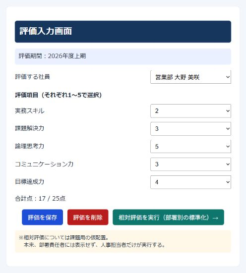
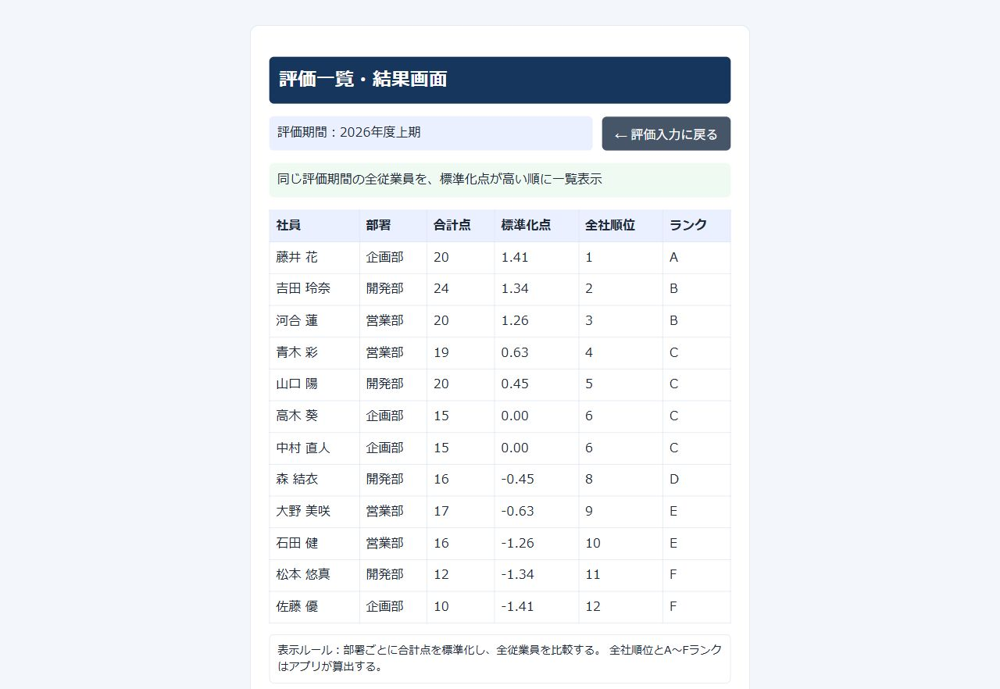

# 人事評価管理システム

社員の評価点を入力・保存し、部署ごとの標準化点から全社順位とA～Fランクを表示する学習用Webアプリケーションです。

| 項目 | 内容 |
| --- | --- |
| 制作 | 屋敷諒／職業訓練の個人制作課題 |
| 制作期間 | 2026年10月、約2週間 |
| 対象 | 架空の3部署・12人、2026年度上期の1期間 |
| 構成 | Reactの画面、Spring Bootの保存・計算処理、MySQL |
| 動作環境 | WindowsのPC内で実行。<br>インターネット上の実行サイトは公開していません。 |

画面と操作は以下の画像で確認できます。\
起動する場合は、[Windowsでの起動・操作手順](docs/setup.md)を参照してください。

## 画面と操作例

掲載している氏名・部署・評価は、すべて動作確認用の架空データです。\
2026年10月18日に、MySQLへ接続した実際のアプリを撮影しました。

### 評価入力画面



部署名・氏名から社員を選択すると、保存済みの評価を読み込めます。\
5項目の点数を1〜5で選び、「評価を保存」で新規保存・更新します。\
「評価を削除」は確認後にその社員の評価だけを削除し、社員・部署は残します。\
全員分が保存済みなら、相対評価を実行できます。

### 評価一覧・結果画面



部署別に標準化した点数の高い順に、全12人の結果を表示します。\
標準化点は小数第2位まで表示し、同順位の次は人数分だけ順位を飛ばします。\
画像では高木葵と中村直人が同率6位、次の森結衣が8位です。\
「評価入力に戻る」で入力画面へ戻れます。

## 開発した背景・理由

職業訓練と並行してビジネスデータ処理の勉強を進めていた際、標準偏差を用いて点数を標準化する考え方を学び、この概念を使った算出アプリを作りたいと考えました。

前職では、社員の相対評価やランク付けが、評価の甘さ・厳しさの違いを踏まえた比較として機能しているのか、という疑問がありました。\
評価の算出業務には関わっていなかったため、具体的な計算方法や一覧化の手順は把握していませんが、評価の甘辛を調整しているという話を聞いたことがありました。

そこで、部署ごとの点数を標準化し、共通の計算ルールで順位・ランクを算出することで、比較用データの作成や調整にかかる時間を減らし、公平な評価を検討しやすくできるのではないかと考え、本アプリを開発しました。

本アプリは、最終的な人事評価を自動で決定することではなく、評価判断のための比較用データを作成することを目的としています。\
算出後にも人による確認・判断が必要です。

## 主な機能

- 部署名・氏名から評価する社員を選択する
- 保存済みの評価を読み込む
- 5項目をそれぞれ1～5の整数で評価し、合計点を表示する
- 評価を新規保存・更新する
- 確認画面で承認した場合に、選択中の社員の保存済み評価だけを削除する
- 部署ごとに点数を標準化し、全社順位とA～Fランクを一覧表示する
- 読み込み・保存・削除・結果取得に失敗した場合に案内を表示する

評価項目は、実務スキル・課題解決力・論理思考力・コミュニケーション力・目標達成力の5つです。\
合計点は最大25点です。

## 使用技術と構成

| 役割                 | 使用技術                   |
| -------------------- | -------------------------- |
| 画面                 | React 19、JavaScript、CSS  |
| 画面の開発・ビルド   | Vite 8、npm                |
| 保存・計算           | Java 21、Spring Boot 4.1.1 |
| データベースとの接続 | Spring Data JPA            |
| データベース         | MySQL 8.4、Docker Compose  |
| 自動テスト           | JUnit、Mockito             |

```text
Chrome → React・Vite（5173）→ Spring Boot（8080）→ MySQL（3311）
```

画面から `/api` への通信は、開発用のViteサーバーがSpring Bootへ転送します。\
MySQLのコンテナ内のポート番号は3306、開発用PCからの接続先は3311です。

## 自分の取り組みとAIの支援範囲

自分で取り組んだのは、前職で感じた課題と制作目的の整理、対象範囲・仕様の判断、短いコードの入力・修正、画面操作とコマンドによる結果確認、設計資料との照合、Gitでの記録とGitHubへの公開・提出です。

AI（Codex）をメンターとして活用し、作業順序、コードの提案と解説、レビュー、不具合調査、テスト方法、README・起動用ファイルなどの作成支援を受けました。\
AIが作成・編集したファイルを含み、独力で全体を設計・実装した作品ではありません。

## 制作で重視したことと学び

### 確認できない動作をそのまま完了にしない

削除処理が速く、「削除中」の表示を目視しきれないことがありました。\
そのまま確認済みとはせず、別の確認方法を求めました。\
AIの支援を受けて通信待ちを再現する確認用ページを用意し、処理中の表示・操作制限・失敗後の解除と点数保持を確認しました。\
詳しくは[画面の動作確認用ページ](hr-evaluation-frontend/checks/README.md)に記載しています。

### 実装だけでなく準備と確認にも時間を見込む

当初は1週間を目標としていましたが、制作には約2週間かかりました。\
画面・保存処理・データベースをつなぐ準備や、接続・失敗時の確認など、取り組んで初めて分かる工程がありました。\
短いコードを書いて動かし、結果を確認して解説を受ける流れを繰り返し、コードに触れることへの慣れと作業量を見積もる意識につながりました。

## 動作確認とテスト

| 確認内容 | 確認結果 |
| --- | --- |
| Java側の自動テスト | 起動確認を含む15件成功（2026年10月17日） |
| 起動用ファイルの部品テスト | 8件成功（2026年10月18日） |
| 画面のビルド | 未使用素材の整理・HTMLの修正後に成功（2026年11月20日） |
| 画面と保存先を使う操作確認 | 登録・更新・削除・再保存、再起動後の評価保持、12人分の結果表示を確認 |
| 失敗時と計算条件 | MySQL停止時の応答・ログ、未保存・人数不足・同一点数の条件を確認 |

上記は各実施日の確認記録です。\
自動テストと、実際の画面・API・MySQLを通す確認は区別しています。\
[テストの実行方法と確認範囲](docs/testing.md)に、実施日・対象・未確認事項を記載しています。

## 対象範囲と制限

架空の3部署・12人、1期間、評価入力と結果一覧の2画面を対象としています。\
ログイン・役割別の操作制限・社員と部署の登録や編集・複数期間・レーダーチャートは未実装です。

相対評価の実行ボタンは課題用に入力画面へ配置しています。\
本来は人事担当者が実行する想定ですが、今回のアプリには役割別の権限制御はありません。

標準化は部署内での相対的な位置を表すものであり、部署間の能力差や評価基準の妥当性を保証しません。\
最終的な人事評価は、人による確認・判断が必要です。\
業務導入や、時間削減・公平性改善の実測結果はありません。

初回構築用SQLは、同じPC内の空の確認用データベースで検証しています。\
別PC・新しいDocker保存領域からのアプリ起動は未確認です。\
その他の確認範囲は[テストの記録](docs/testing.md#確認済みの動作と残っている確認)を参照してください。

## 起動方法と詳細資料

- [Windowsでの起動・操作手順](docs/setup.md)：共通準備、起動・停止用ファイル、PowerShellでの手順、困ったときの確認。
- [技術仕様](docs/technical.md)：データ構成とER図、フォルダ構成、計算ルール、API一覧。
- [テストと確認記録](docs/testing.md)：実行コマンド、確認結果、未確認事項。
