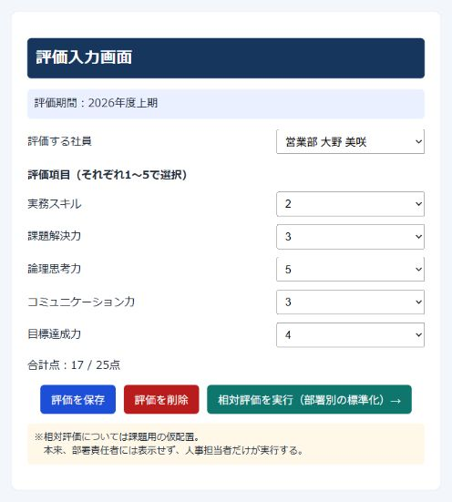
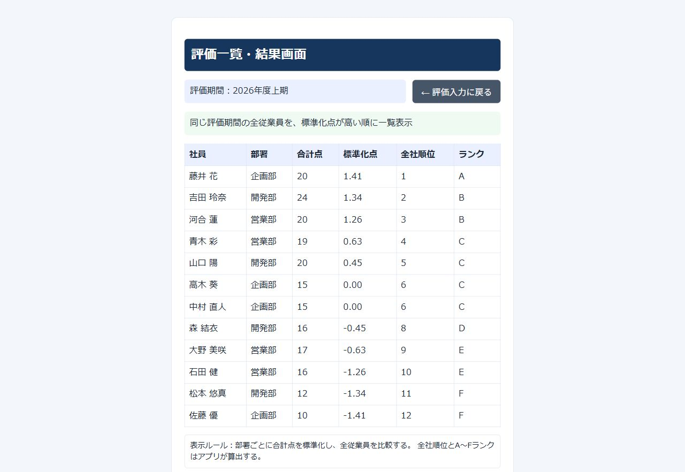
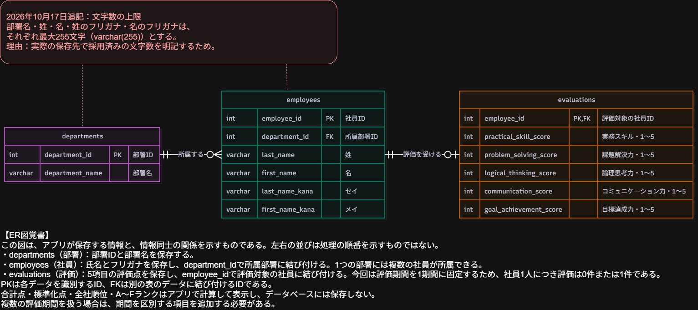

# 人事評価管理システム

架空の社員の評価を入力・保存し、部署ごとの標準化点から全社順位とA～Fランクを表示する学習用Webアプリケーションです。\

画面はReact、保存と計算はSpring Boot、データの保存先はMySQLで構成しています。\

> 提出準備中です。\
> 初回データベース構築用のSQLと手順を用意し、同じPC内の新しい確認用データベースで表の作成・初期登録・再実行時の評価保持を確認しています。\
> 別のPCや新しいDockerの保存領域から、アプリの起動まで通す確認は未実施です。\

## 開発した背景・理由

職業訓練と並行してビジネスデータ処理の勉強を進めていた際、標準偏差を用いて点数を標準化する考え方を学び、この概念を使った算出アプリを作りたいと考えました。\

前職では、社員の相対評価やランク付けが、評価の甘さ・厳しさの違いを踏まえた比較として機能しているのか、という疑問がありました。\
評価の算出業務には関わっていなかったため、具体的な計算方法や一覧化の手順は把握していませんが、評価の甘辛を調整しているという話を聞いたことがありました。\

そこで、部署ごとの点数を標準化し、共通の計算ルールで順位・ランクを算出することで、比較用データの作成や調整にかかる時間を減らし、公平な評価を検討しやすくできるのではないかと考え、本アプリを開発しました。\

本アプリは、最終的な人事評価を自動で決定することではなく、評価判断のための比較用データを作成することを目的としています。\
算出後にも人による確認・判断が必要です。\

## 工夫した点・苦労した点の前提

以下は、アプリの機能や技術そのものではなく、今回の学習・制作の進め方について記載しています。\
開発開始時点では、自力でコードをほとんど書けず、何から着手し、どのようなコードを書けばよいかも分からない状態のため、このような内容としています。\

### 工夫した点：AIをメンターとして活用し、コードを書く経験を積む

AI（Codex）をメンターとして活用し、作業の順序やコードの意味を教わりながら、一から制作を進めました。\
ファイル・設計資料・PC画面をCodeX自身が確認できる機能や自動操作機能も使い、コードの提案・レビュー、不具合の調査、資料の整備などの支援を受けました。\
AIが作成・編集したファイルも含まれています。\

今回の制作では、「実際にコードを書いてみる経験を積む時間」と位置付け、短いコードを自分で書き、動かして結果を確かめ、解説を受けることを繰り返しました。\
独力で設計・実装できる状態に達したということではありませんが、それまでの数か月の学習と比べ、コードに触れることへの慣れが進んだ実感があります。\

### 苦労した点：開発に必要な作業量を体験したこと

当初は1週間程度での作成を目標にしていましたが、実際には想定以上の作業（2週間）が必要でした。\
「データを送る」という一つの操作でも、そのための準備や複数のファイルが必要であり、画面・保存処理・データベースをつなぐ工程があることを体験しました。\

テストでも、接続状況の確認や失敗時の動作確認など、取り組んで初めて分かる工程が多くありました。\
苦労はありましたが、機能の実装だけでなく、準備・確認・修正にも時間が必要であると学び、開発スケジュールの規模感をつかむ経験になりました。\

## 提出条件への対応状況

2026年10月16日に「修了考査提出の注意点」を確認し、提出に向けて次の対応を追加する方針としました。\
以下は未完了の作業です。\

- 初回データベース構築手順を使い、新しい環境でアプリの起動まで確認する（SQLと手順の整備、同じPC内の空のデータベースでの確認は実施済み）。\
- 提出するGitHubリポジトリと公開対象を確認し、publicで閲覧できる状態にする。\

アプリケーションのインターネット公開は任意のため、現時点では開発用PC内での実行を対象としています。\

2026年10月17日更新：保存済み評価の削除を追加し、画面での削除・再保存と、成功・社員なし・評価なしの3件の自動テストを確認しました。\
社員・部署は削除しません。\

## 主な機能

- 部署名・氏名から評価する社員を選択する
- 保存済みの評価を読み込む
- 5項目をそれぞれ1～5の整数で評価し、合計点を表示する
- 評価を新規保存・更新する
- 確認画面で承認した場合に、選択中の社員の保存済み評価だけを削除する
- 部署ごとに点数を標準化し、全社順位とA～Fランクを一覧表示する
- 読み込み・保存・削除・結果取得に失敗した場合に案内を表示する

評価項目は、実務スキル・課題解決力・論理思考力・コミュニケーション力・目標達成力の5つです。\
合計点は最大25点です。\

## 画面と操作例

掲載している氏名・部署・評価は、すべて動作確認用の架空データです。\
2026年10月18日に、MySQLへ接続した実際のアプリを撮影しました。\
撮影のために評価点の保存・削除は行っていません。\

### 評価入力画面



部署名・氏名から社員を選択すると、保存済みの評価を読み込めます。\
5項目の点数を1〜5で選び、「評価を保存」で新規保存・更新します。\
「評価を削除」は確認後にその社員の評価だけを削除し、社員・部署は残します。\
全員分が保存済みなら、相対評価を実行できます。\

### 評価一覧・結果画面



部署別に標準化した点数の高い順に、全12人の結果を表示します。\
標準化点は小数第2位まで表示し、同順位の次は人数分だけ順位を飛ばします。\
画像では高木葵と中村直人が同率6位、次の森結衣が8位です。\
「評価入力に戻る」で入力画面へ戻れます。\

## ER図と保存するデータ



2026年10月18日に提出設計の原本から書き出したER図です。\
元の項目と、文字数を補足した赤字の枠を含めて掲載しています。\
画像を開くと拡大して確認できます。\

| 表                  | 保存する内容                               | 関係                                      |
| ------------------- | ------------------------------------------ | ----------------------------------------- |
| departments（部署） | 部署番号・部署名                           | 1つの部署に複数の社員が所属               |
| employees（社員）   | 社員番号・姓・名・各フリガナ・所属部署番号 | 社員は必ず1つの部署に所属                 |
| evaluations（評価） | 社員番号・5項目の評価点                    | 社員1人につき、保存済み評価は0件または1件 |

`PK`は各行を区別する番号、`FK`は別の表につなぐ番号です。\
部署名・氏名・フリガナは各最大255文字です。\
合計点・標準化点・全社順位・ランクは計算して表示するため、表には保存しません。\
今回の評価期間は1期間に固定しています。\

## 今回の対象範囲

| 項目       | 内容                                               |
| ---------- | -------------------------------------------------- |
| 対象データ | 架空の3部署・12人（営業部・企画部・開発部に各4人） |
| 評価期間   | 2026年度上期の1期間                                |
| 画面       | 評価入力画面、評価一覧・結果画面                   |
| 利用環境   | 開発用PC内、PC版Chrome                             |
| データ保存 | 社員ごとの5項目の評価点をMySQLに保存               |

ログイン、役割による操作制限、社員・部署の登録・編集・削除、複数の評価期間、レーダーチャートは今回の実装対象に含めていません。\

相対評価の実行ボタンは、課題用として評価入力画面に配置しています。\
本来は人事担当者だけが実行する想定であり、その理由を画面下部に記載しています。\

## 使用技術と構成

| 役割                 | 使用技術                   |
| -------------------- | -------------------------- |
| 画面                 | React 19、JavaScript、CSS  |
| 画面の開発・ビルド   | Vite 8、npm                |
| 保存・計算           | Java 21、Spring Boot 4.1.1 |
| データベースとの接続 | Spring Data JPA            |
| データベース         | MySQL 8.4、Docker Compose  |
| 自動テスト           | JUnit、Mockito             |

```text
Chrome → React・Vite（5173）→ Spring Boot（8080）→ MySQL（3311）
```

画面から `/api` への通信は、開発用のViteサーバーがSpring Bootへ転送します。\
MySQLのコンテナ内のポート番号は3306、開発用PCからの接続先は3311です。\

## フォルダ構成

```text
課題作成/
├─ README.md                    アプリ全体の説明
├─ compose.yaml                 MySQLの起動設定
├─ .env                         パスワードの設定（Git管理対象外）
├─ .env.example                 パスワード設定のひな型（実際の値は含まない）
├─ 起動.cmd                     Windows用の起動ファイル
├─ 停止.cmd                     起動ファイルで動かしたアプリの停止
├─ scripts/                     起動用ファイルの処理と確認テスト
├─ schema.sql                   部署・社員・評価の表を作るSQL
├─ seed-departments.sql          架空の部署3件を登録するSQL
├─ seed-employees.sql            架空の社員12人を登録するSQL
├─ update-departments.sql        開発時に使った既存部署名の修正用SQL
├─ hr-evaluation-backend/        保存・計算のプログラム
├─ hr-evaluation-frontend/       画面のプログラム
└─ 開発の目次.md                 開発手順・進捗・確認結果
```

## 起動方法（Windows）

起動方法は、次の2通りを用意しています。\
どちらも同じアプリを起動する方法であり、「正式・非正式」という違いはありません。\

- **方法A：起動用ファイルを使う** ― コマンドを一つずつ入力せずに準備・起動したい場合。\
- **方法B：Windows PowerShellでコマンドを実行する** ― 準備・起動の処理を順番に確認しながら進めたい場合。\

まず「共通の事前準備」を行い、その後はいずれか一方の方法で起動してください。\
2つの方法を同時に実行する必要はありません。\
この案内は、ZIPを展開するかGitから取得して、ファイルをPC内に保存した状態を前提にしています。\

### 共通の事前準備

#### 必要なもの

- Java 21
- Node.jsとnpm（Node.js 20.19以降の20系、または22.12以降）
- DockerとDocker Composeが使える環境
- PC版Chrome

Mavenは同梱の `mvnw.cmd` から実行します。\
別途Mavenをインストールする手順は不要です。\
初回実行時には必要なライブラリを取得します。\
初回のライブラリ・MySQLイメージの取得には、インターネット接続と数分以上の待ち時間が必要になる場合があります。\
Docker Desktopを起動し、Dockerが利用できる状態にしてください。\
起動用ファイルは、これらのソフト自体をインストールするものではありません。\

#### パスワードの設定

`compose.yaml`と同じフォルダの`.env.example`をコピーして、`.env`という名前で保存します。\
`.env.txt`にならないよう、Windowsのエクスプローラーでファイル名の拡張子を表示して確認してください。\
ファイル内の`replace_with_...`の2つの値を、それぞれ自分の環境用のパスワードへ置き換えます。\
`DB_PASSWORD`と`DB_ROOT_PASSWORD`の名前は変更しません。\
前者は一般ユーザー用、後者は管理者用のパスワードです。\
MySQLとJavaの設定として共通に読み込むため、半角英数字を組み合わせた十分に長い値を指定し、値を引用符で囲まないでください。\
実際のパスワードを提出文やGitHubに載せる必要はありません。\

- 一般ユーザー名は `hr_user`、データベース名は `hr_evaluation` です。\
- Spring Bootは `.env` の `DB_PASSWORD` を読み込みます。\
- 初期設定済みの環境では、MySQLに設定済みのパスワードを使います。\
  `.env` だけを書き換えても、既存のMySQLのパスワードは変更されません。\
- `.env` は `.gitignore` でGit管理対象から除外しています。\
  実際のパスワードはREADMEやGitに記載しません。\

### 方法A：起動用ファイルを使う

1. 共通の事前準備を済ませ、`起動.cmd`をダブルクリックします。\
2. 表示される進捗に従って待ちます。\
   必要なソフトの確認、MySQLの起動、表・部署・社員の準備、画面用ライブラリの準備、バックエンドとフロントエンドの起動を順番に行います。\
3. 起動が完了すると既定のブラウザに`http://127.0.0.1:5173/`を開きます。\
   Chrome以外のブラウザが開いた場合は、このURLをChromeで開いてください。\
   自動で開かない場合もアプリは起動を続けるので、URLを手動で開けます。\
4. 使用中は起動用ファイルのウィンドウを開いたままにします。\
5. 終了する場合は`停止.cmd`をダブルクリックします。\
   起動用ファイルのウィンドウで`Ctrl + C`を押しても停止処理を依頼できます。\

`.env`がない場合は、起動用ファイルがひな型を作成して案内を出します。\
パスワードの設定後、もう一度`起動.cmd`を実行してください。\
初回の評価は0件であり、画面から全12人の評価を保存すると相対評価を実行できます。\

既存の部署・社員の初期登録は同じ番号の値を上書きせず、保存済み評価も削除しません。\
初期準備SQLは既存の表の構造を変更するものではありません。\
8080番または5173番が使用中の場合は、使用中のプログラムを勝手に終了せず、案内を出して停止します。\
手動で同じアプリを起動している場合は先に終了してください。\

停止用ファイルは、この起動用ファイルから動かしたバックエンド・フロントエンドを停止します。\
MySQLも今回新たに起動した場合だけ停止し、起動前から動作していたMySQLはそのまま残します。\
データを保存しているDockerの領域を削除する処理はありません。\

起動に失敗した場合は、表示された案内を確認してください。\
バックエンド・フロントエンドの詳細は`.launcher/backend.log`と`.launcher/frontend.log`に残ります。\
`.launcher`はGit管理対象外です。\
手順を一つずつ確認したい場合は、次の方法Bを使用できます。\

### 方法B：Windows PowerShellでコマンドを実行する

起動用ファイルを使わず、次の手順を順番に実行する方法です。\
初めて使う環境は「初回のデータベース準備」から、準備済みの環境は「アプリの起動」から進めてください。\

#### 初回のデータベース準備

2026年10月18日追加：初回構築用の表・部署・社員の準備手順です。\
Windows PowerShellで、このREADMEと`compose.yaml`があるフォルダから実行します。\
先に前項の`.env`を設定してください。\

1. Dockerを利用できる状態にし、MySQLを起動します。\

```powershell
docker compose up -d db
docker compose ps
```

初めて使う保存領域では、`compose.yaml`の設定によりデータベース`hr_evaluation`と一般ユーザー`hr_user`が用意されます。\
表と初期データは次の手順で手動登録します。\
起動直後に接続を拒否された場合は、MySQLの準備が終わってからやり直してください。\

2. 3つのSQLファイルをMySQLのコンテナ内へコピーします。\

```powershell
docker cp .\schema.sql hr-evaluation-db-1:/tmp/hr-evaluation-schema.sql
docker cp .\seed-departments.sql hr-evaluation-db-1:/tmp/hr-evaluation-seed-departments.sql
docker cp .\seed-employees.sql hr-evaluation-db-1:/tmp/hr-evaluation-seed-employees.sql
```

3. 表→部署→社員の順番に実行します。\
   途中で`ERROR`が出た場合は、そこで止めて内容を確認します。\
   パスワードはコンテナ内の環境変数から渡すため、コマンドへ直接記入しません。\

```powershell
docker exec hr-evaluation-db-1 sh -c 'MYSQL_PWD=$MYSQL_ROOT_PASSWORD mysql --default-character-set=utf8mb4 --user=root --database=hr_evaluation < /tmp/hr-evaluation-schema.sql'
docker exec hr-evaluation-db-1 sh -c 'MYSQL_PWD=$MYSQL_ROOT_PASSWORD mysql --default-character-set=utf8mb4 --user=root --database=hr_evaluation < /tmp/hr-evaluation-seed-departments.sql'
docker exec hr-evaluation-db-1 sh -c 'MYSQL_PWD=$MYSQL_ROOT_PASSWORD mysql --default-character-set=utf8mb4 --user=root --database=hr_evaluation < /tmp/hr-evaluation-seed-employees.sql'
```

ここでの`root`は初回準備用です。\
通常のアプリ接続には、既存の設定どおり`hr_user`を使います。\
`utf8mb4`は日本語を扱うための文字コード指定です。\

4. 作成結果を確認します。\

```powershell
'SHOW TABLES; SELECT (SELECT COUNT(*) FROM departments) AS departments_count, (SELECT COUNT(*) FROM employees) AS employees_count, (SELECT COUNT(*) FROM evaluations) AS evaluations_count;' | docker exec -i hr-evaluation-db-1 sh -c 'MYSQL_PWD=$MYSQL_ROOT_PASSWORD mysql --user=root --database=hr_evaluation'
```

初回の空の環境では、表が`departments`・`employees`・`evaluations`の3つ、部署3件・社員12件・評価0件になります。\
評価点は最初から登録せず、画面で入力・保存します。\
全員分の保存が終わるまで相対評価は実行できません。\
準備後は、次節のバックエンド・フロントエンドの起動へ進みます。\

既存の表は`IF NOT EXISTS`で作成を省略します。\
既存の表の構造を更新する機能はありません。\
部署・社員の初期登録も同じ番号の既存データを上書きしません。\
保存済み評価がある環境では、評価件数は0件とは限りません。\

`update-departments.sql`は、開発時に既存の部署名を修正するために使用したファイルです。\
既存名を変更する処理のため、初回構築・再実行の手順には含めません。\

##### 初回準備SQLの確認範囲

2026年10月18日、開発用の`hr_evaluation`とは別の空のデータベース`hr_evaluation_setup_check`を同じMySQL内に作り、上記3ファイルを適用しました。\
3表、3部署、社員12人と所属先、全項目の`NOT NULL`、社員から部署・評価から社員への2つの関連付けを確認しました。\

再実行後も部署3件・社員12件・評価0件で重複しないことを確認しました。\
その後、社員番号3へ2・3・5・3・4の評価を1件登録し、3ファイルを再実行しても点数と1件の保存が保持されることを確認しました。\
この確認用データベースは通常のアプリ接続先に設定していません。\
別PC・新しいDockerの保存領域での起動確認とは区別します。\

#### アプリの起動

Windows PowerShellで、3つのターミナルを使います。\
各ターミナルの最初の作業場所は、このREADMEと`compose.yaml`があるフォルダとします。\

##### 1. MySQLを起動する

Dockerが利用できる状態にして、実行します。\

```powershell
docker compose up -d
docker compose ps
```

`db` が起動していることを確認します。\
MySQLの起動直後は接続できるまで少し待つ場合があります。\

##### 2. 保存・計算のプログラムを起動する

別のターミナルで実行します。\

```powershell
cd .\hr-evaluation-backend
.\mvnw.cmd spring-boot:run
```

`Started HrEvaluationBackendApplication` が表示されたら起動完了です。\
このターミナルは開いたままにします。\

##### 3. 画面を起動する

さらに別のターミナルで実行します。\
`npm ci` は初回、または必要なライブラリを揃え直す場合に実行します。\

```powershell
cd .\hr-evaluation-frontend
npm ci
npm run dev -- --host 127.0.0.1
```

このターミナルも開いたままにし、Chromeで [評価入力画面](http://127.0.0.1:5173/) を開きます。\
5173が使用中の場合は、ターミナルに表示されたURLを確認します。\

#### PowerShellで起動した場合の終了方法

1. 画面を起動したターミナルで `Ctrl + C` を押します。\
2. Spring Bootを起動したターミナルで `Ctrl + C` を押します。\
3. `課題作成` フォルダのターミナルで次を実行します。\

```powershell
docker compose stop
```

## 操作方法

1. 「評価する社員」から社員を選びます。\
2. 保存済みの評価があれば、5項目の点数が読み込まれます。\
   未保存の場合は未選択になります。\
3. 5項目をそれぞれ1～5で選択し、合計点を確認します。\
4. 「評価を保存」を押します。\
   初回は「保存しました」、更新時は「更新しました」と表示されます。\
5. 全員分を保存したら、「相対評価を実行（部署別の標準化）→」を押します。\
6. 結果画面で、社員・部署・合計点・標準化点・全社順位・ランクを確認します。\
7. 「← 評価入力に戻る」で入力画面へ戻れます。\

社員と5項目が選ばれ、評価の読み込み中・保存中・削除中・相対評価の取得中ではなく、評価の読み込みに失敗していない場合に保存できます。\
全員の保存状況を確認でき、処理中ではない場合に相対評価を実行できます。\

保存済み評価を削除する場合は、社員を選んで「評価を削除」を押し、確認画面でOKを選びます。\
取消時は削除しません。\
成功すると社員選択を保ったまま5項目が未選択・合計0点となり、「削除しました」と表示します。\
全員分を保存し直すまで相対評価は実行できません。\
失敗時は画面の点数を維持して案内し、社員を選び直して保存状態を確認します。\
最初の保存状況の確認中や、読み込み・保存・削除・計算の途中には削除できません。\

**相対評価に使うのは保存済みの点数です。\
点数を変更した場合は、先に「評価を保存」を押してから相対評価を実行してください。\
**

## 計算ルール

### 合計点と標準化点

5項目の合計点から、部署ごとに平均点と母標準偏差を求めます。\
母標準偏差は、平均との差の二乗の合計を部署人数で割り、その平方根を求める方法です。\
Excelの `STDEV.P` に相当します。\

```text
標準化点 ＝（社員の合計点 − 所属部署の平均点）÷ 所属部署の母標準偏差
```

この式はExcelの `STANDARDIZE` と同じ考え方です。\
画面では標準化点を小数第2位まで表示します。\
順位の判定には、表示用に丸める前の値を使います。\

### 全社順位とランク

- 全社順位は、部署別に算出した標準化点を全社員で比較して求めます。\
- 標準化点の差の絶対値が `0.0000000001`（`1e-10`）未満なら、同点として扱います。\
- 同点は同順位・同ランクとし、その次の順位は人数分だけ飛ばします。\
  例：1位・1位・3位。\
- 結果一覧は、丸め前の標準化点が高い順に表示します。\

```text
順位率（％）＝ 全社順位 ÷ 評価対象人数 × 100
```

| 順位率           | ランク |
| ---------------- | ------ |
| 10％以下         | A      |
| 10％超～30％以下 | B      |
| 30％超～50％以下 | C      |
| 50％超～70％以下 | D      |
| 70％超～90％以下 | E      |
| 90％超           | F      |

ただし、**1位・同率1位は、人数にかかわらず全員A**とします。\

### 計算を止める条件

- 評価が未保存の社員がいる：該当する全員の氏名を案内します。\
- 社員が1人の部署がある：部署名と人数不足を案内します。\
- 部署全員の合計点が同じ：部署名と、合計点が同じであることを案内します。\

これらの場合、結果取得APIは400を返します。\
予期しない失敗は500と固定の案内文を返します。\
画面は結果画面へ移動せず、入力画面に案内を表示します。\

合計点・標準化点・順位・ランクは、MySQLの保存項目に追加せず、評価点から算出します。\

## API一覧

APIは、画面が保存・計算のプログラムへ依頼するための窓口です。\

| 通信方法 | パス                            | 内容                                   |
| -------- | ------------------------------- | -------------------------------------- |
| GET      | `/api/employees`                | 社員一覧を取得                         |
| GET      | `/api/evaluations/{employeeId}` | 社員の保存済み評価を取得               |
| PUT      | `/api/evaluations/{employeeId}` | 社員の評価を新規保存・更新             |
| DELETE   | `/api/evaluations/{employeeId}` | 社員の保存済み評価だけを削除           |
| GET      | `/api/rankings`                 | 保存済み評価から相対評価を算出して取得 |

評価の保存は初回201・更新200、入力不備は400、社員が存在しない場合は404です。\
評価の取得は、社員が存在しない場合と評価が未保存の場合に404を返します。\

評価の削除は成功時204（本文なし）、社員が存在しない場合や評価が未保存の場合は404を返します。\

## ビルドとテスト

### 起動用ファイルの確認

このREADMEと`compose.yaml`があるフォルダで実行します。\

```powershell
node --test scripts/launcher-core.test.mjs
```

2026年10月18日、Node.jsの対応バージョン、パスワードの未設定・ひな型検出、表作成失敗時の後続処理の中止、停止依頼による起動待ちの中断、待ち時間を超えた場合の失敗判定、ブラウザ表示の終了・失敗・時間切れを調べる8件が成功しました。\
このテストはMySQLやアプリを実際に起動するものではありません。\
実行中のアプリが8080番を使用している場合に、案内を出して終了し、既存アプリを勝手に停止しない動作も確認しました。\
既存のWindows開発環境で、起動処理による準備・バックエンドとフロントエンドの起動・ブラウザ表示の起動命令・停止処理を通して確認しました。\
起動後に画面側のURLから社員12人・大野美咲の保存済み評価2・3・5・3・4（17点）・相対評価12人を取得でき、停止後に8080番・5173番への応答がなくなることを確認しました。\
ブラウザ画面でも保存済みの17点と12人分の結果を確認しています。\
利用者の操作でも、`起動.cmd`の「起動しました」と、`停止.cmd`の「停止処理が終了しました」の表示を確認しました。\
起動前から動作していたMySQLを残す案内も表示されました。\
別PC・新しいDockerの保存領域からの初回起動まで確認したものではありません。\

### 画面のビルド

`hr-evaluation-frontend` フォルダで実行します。\

```powershell
npm run build
```

成功すると `dist` フォルダが作成されます。\
これは画面のコードを配布用にまとめる処理であり、インターネットへの公開ではありません。\

現在の `/api` の転送設定は開発用サーバーに設定しています。\
`dist` を置くだけで保存・計算まで動く公開構成にはなっていません。\

### 相対評価の失敗条件・返却内容のテスト

`hr-evaluation-backend` フォルダで実行します。\

```powershell
.\mvnw.cmd "-Dtest=RankingFailureTests,RankingControllerTests" test
```

以下の5件を確認します。\
この2つのテストクラスは実際のMySQLを使用せず、保存データを変更しません。\

| テストクラス           | 確認する内容                                             |
| ---------------------- | -------------------------------------------------------- |
| RankingFailureTests    | 未保存の社員全員の氏名を案内する                         |
| RankingFailureTests    | 社員が1人の部署では計算を止める                          |
| RankingFailureTests    | 内訳が異なっても、部署全員の合計点が同じなら計算を止める |
| RankingControllerTests | 計算できない条件では400と具体的な理由を返す              |
| RankingControllerTests | 予期しない失敗では500と固定の案内文を返す                |

### 評価削除のテスト

`hr-evaluation-backend` フォルダで実行します。\

```powershell
.\mvnw.cmd "-Dtest=EvaluationDeleteTests" test
```

社員と評価が存在する場合の204、社員が存在しない場合の404、社員は存在するが評価が未保存の場合の404の3件を確認します。\
社員自体の削除を呼び出さないことも確認します。\
保存先の代役を使うため、実際のMySQLは変更しません。\
これは処理を直接呼ぶ確認であり、HTTP通信全体の試験とは区別します。\

削除中の表示と通信失敗後の解除を繰り返し確認する方法は、[画面の動作確認用ページの説明](hr-evaluation-frontend/checks/README.md)を参照してください。\

### 計算の境目・同順位と、確認済みテストの一括実行

`RankingCalculatorTests`では、完全な同点、小さな端数差、同点とする差を超えた場合、差が境目ちょうどの場合、A〜Fの各境目とその直後、少人数でも1位はAになる条件の6件を確認します。\

`hr-evaluation-backend` フォルダで、次の4クラスをまとめて実行できます。\

```powershell
.\mvnw.cmd "-Dtest=RankingCalculatorTests,RankingFailureTests,RankingControllerTests,EvaluationDeleteTests" test
```

2026年10月17日、合計14件が成功し、失敗0・エラー0・省略0を確認しました。\
これらは計算や受付処理を直接呼ぶ確認で、実際のMySQLは変更しません。\
ブラウザからHTTP 400・500を受け取る確認とは区別します。\

### 起動確認を含む全テスト

MySQLを起動した状態で、`hr-evaluation-backend` フォルダから実行します。\

```powershell
.\mvnw.cmd test
```

2026年10月17日19:21:42、起動確認1件と上記14件の合計15件が成功しました。\
失敗0・エラー0・省略0、`BUILD SUCCESS`を確認しています。\
部署名・氏名・フリガナ・所属部署の未設定不可の指定と、ログ保存の設定を追加した後の結果です。\

予期しない失敗の確認テストでは、確認用のエラー記録が出る場合があります。\
成功・失敗は末尾の集計で判断してください。\

## 確認済みの動作と残っている確認

2026年10月18日時点の確認結果です。\
個別の実施日は各項目を参照してください。\

| 項目                                                     | 確認結果                                                                                                                     |
| -------------------------------------------------------- | ---------------------------------------------------------------------------------------------------------------------------- |
| 評価の初回保存・更新・社員を選び直しての再表示           | 開発環境で確認済み                                                                                                           |
| 12人分の相対評価・結果画面・入力画面へ戻る操作           | 開発環境で確認済み                                                                                                           |
| 小数第2位表示、同率6位・6位・8位の表示                   | 確認済み                                                                                                                     |
| Spring Boot停止時の結果取得失敗の案内、再起動後の再実行  | 確認済み                                                                                                                     |
| 保存済み評価の削除・取消・再保存・選び直して再表示       | 開発環境で確認済み                                                                                                           |
| 削除中の表示・操作無効化・通信失敗後の解除と点数保持     | 実際の画面部品と仮の通信で確認済み                                                                                           |
| 最新画面のビルド                                         | 削除対応後に成功（2026年10月16日）                                                                                           |
| 同順位・計算の境目・相対評価の失敗・評価削除の自動テスト | 4クラス合計14件成功（2026年10月17日）、失敗0・エラー0・省略0                                                                 |
| 起動確認を含む全自動テスト                               | 5クラス合計15件成功（2026年10月17日19:21:42）、失敗0・エラー0・省略0                                                         |
| MySQL停止時の相対評価500と原因ログ                       | APIの500・固定の案内文・原因を含むログファイルを確認。<br>MySQL復旧後の読み込み・12人分の結果表示も確認                          |
| 初回データベース構築用SQL                                | 同じPC内の空の確認用データベースで3表・3部署・社員12人・必須項目・関連付け・再実行時の件数と評価保持を確認（2026年10月18日） |
| 別PC・新しいDocker保存領域からアプリ起動まで             | 未実施。<br>上記のSQL確認とは区別する                                                                                            |
| MySQLとSpring Bootの停止・再起動後の評価保持             | 保存し直さず大野美咲の5項目と17点を確認。<br>結果表の12人・72項目が期待値と一致（2026年10月17日）                                |
| 実際のHTTP 400・500を使う画面からの一連の確認            | 未実施。<br>窓口を直接呼ぶ上記テストと区別する                                                                                   |
| 提出設計との全項目の最終照合                             | 継続中                                                                                                                       |

## よくある起動時の確認

- **画面が開かない**：Viteのターミナルが起動したままか、表示されたURLが正しいか確認します。\
- **社員一覧や評価を読み込めない**：MySQLとSpring Bootの起動状態を確認します。\
  停止していたものを起動したあと、画面を再読み込みします。\
- **相対評価を実行できない**：全員の評価が保存済みか、保存状況の確認に失敗していないか確認します。\
- **MySQLへ接続できない**：`docker compose ps`、開発用PCの3311番、既存データベースと `.env` のパスワードの一致を確認します。\

詳しい開発の経過は [開発の目次](開発の目次.md) を参照してください。\
