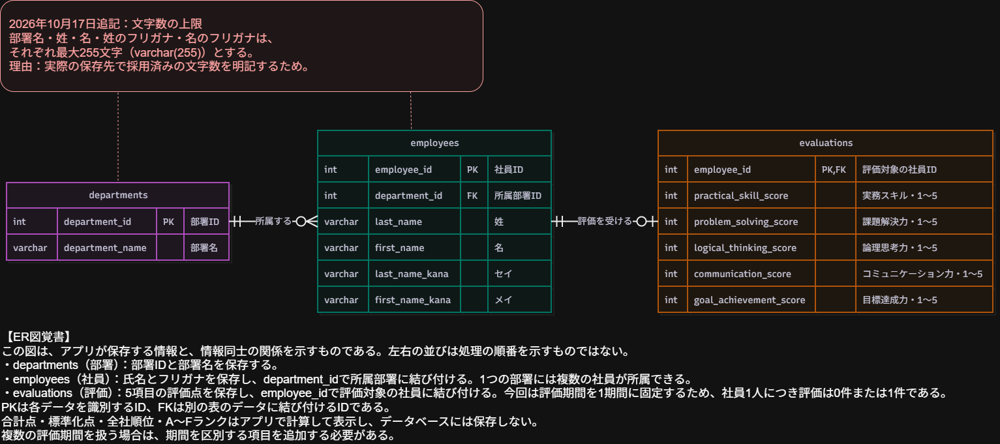

# 技術仕様

[アプリの概要に戻る](../README.md)

## ER図と保存するデータ



2026年10月18日に提出設計の原本から書き出したER図です。\
元の項目と、文字数を補足した赤字の枠を含めて掲載しています。\
画像を開くと拡大して確認できます。

| 表                  | 保存する内容                               | 関係                                      |
| ------------------- | ------------------------------------------ | ----------------------------------------- |
| departments（部署） | 部署番号・部署名                           | 1つの部署に複数の社員が所属               |
| employees（社員）   | 社員番号・姓・名・各フリガナ・所属部署番号 | 社員は必ず1つの部署に所属                 |
| evaluations（評価） | 社員番号・5項目の評価点                    | 社員1人につき、保存済み評価は0件または1件 |

`PK`は各行を区別する番号、`FK`は別の表につなぐ番号です。\
部署名・氏名・フリガナは各最大255文字です。\
合計点・標準化点・全社順位・ランクは計算して表示するため、表には保存しません。\
今回の評価期間は1期間に固定しています。

## フォルダ構成

```text
hr-evaluation/
├─ README.md                   アプリの概要
├─ compose.yaml                MySQLの起動設定
├─ .env.example                設定のひな型
├─ 起動.cmd・停止.cmd          Windows用の起動と停止
├─ schema.sql                  表の作成
├─ seed-departments.sql        部署の初期データ
├─ seed-employees.sql          社員の初期データ
├─ hr-evaluation-backend/       保存と計算の処理
├─ hr-evaluation-frontend/      画面と画面確認用ページ
├─ scripts/                    起動用の処理とテスト
└─ docs/                       起動手順・技術仕様・テスト記録・画像
   └─ archive/                 開発時の学習記録と旧SQL
```

実際のパスワードを保存する`.env`、実行ログ、生成物はGit管理の対象外です。


## 計算ルール

### 合計点と標準化点

5項目の合計点から、部署ごとに平均点と母標準偏差を求めます。\
母標準偏差は、平均との差の二乗の合計を部署人数で割り、その平方根を求める方法です。\
Excelの `STDEV.P` に相当します。

```text
標準化点 ＝（社員の合計点 − 所属部署の平均点）÷ 所属部署の母標準偏差
```

この式はExcelの `STANDARDIZE` と同じ考え方です。\
画面では標準化点を小数第2位まで表示します。\
順位の判定には、表示用に丸める前の値を使います。

### 全社順位とランク

- 全社順位は、部署別に算出した標準化点を全社員で比較して求めます。\
- 標準化点の差の絶対値が `0.0000000001`（`1e-10`）未満なら、同点として扱います。\
- 同点は同順位・同ランクとし、その次の順位は人数分だけ飛ばします。\
  例：1位・1位・3位。\
- 結果一覧は、丸め前の標準化点が高い順に表示します。

```text
順位率（％）＝ 全社順位 ÷ 評価対象人数 × 100
```

| 順位率           | ランク |
| ---------------- | ------ |
| 10％以下         | A      |
| 10％超～30％以下 | B      |
| 30％超～50％以下 | C      |
| 50％超～70％以下 | D      |
| 70％超～90％以下 | E      |
| 90％超           | F      |

ただし、**1位・同率1位は、人数にかかわらず全員A**とします。

### 計算を止める条件

- 評価が未保存の社員がいる：該当する全員の氏名を案内します。\
- 社員が1人の部署がある：部署名と人数不足を案内します。\
- 部署全員の合計点が同じ：部署名と、合計点が同じであることを案内します。

これらの場合、結果取得APIは400を返します。\
予期しない失敗は500と固定の案内文を返します。\
画面は結果画面へ移動せず、入力画面に案内を表示します。

合計点・標準化点・順位・ランクは、MySQLの保存項目に追加せず、評価点から算出します。

## API一覧

APIは、画面が保存・計算のプログラムへ依頼するための窓口です。

| 通信方法 | パス                            | 内容                                   |
| -------- | ------------------------------- | -------------------------------------- |
| GET      | `/api/employees`                | 社員一覧を取得                         |
| GET      | `/api/evaluations/{employeeId}` | 社員の保存済み評価を取得               |
| PUT      | `/api/evaluations/{employeeId}` | 社員の評価を新規保存・更新             |
| DELETE   | `/api/evaluations/{employeeId}` | 社員の保存済み評価だけを削除           |
| GET      | `/api/rankings`                 | 保存済み評価から相対評価を算出して取得 |

評価の保存は初回201・更新200、入力不備は400、社員が存在しない場合は404です。\
評価の取得は、社員が存在しない場合と評価が未保存の場合に404を返します。

評価の削除は成功時204（本文なし）、社員が存在しない場合や評価が未保存の場合は404を返します。
